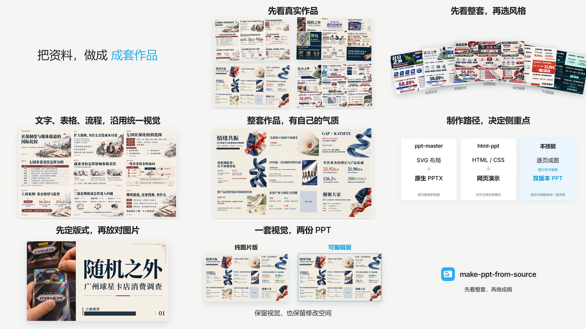
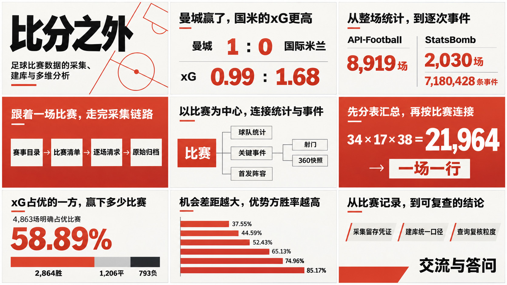
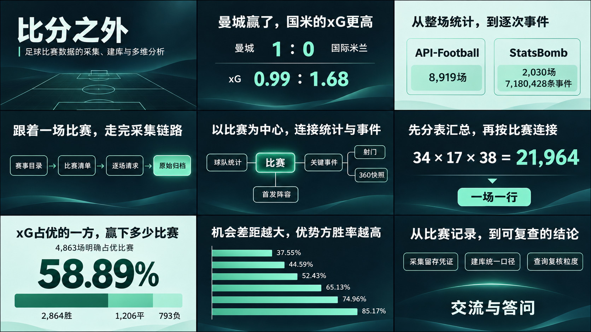
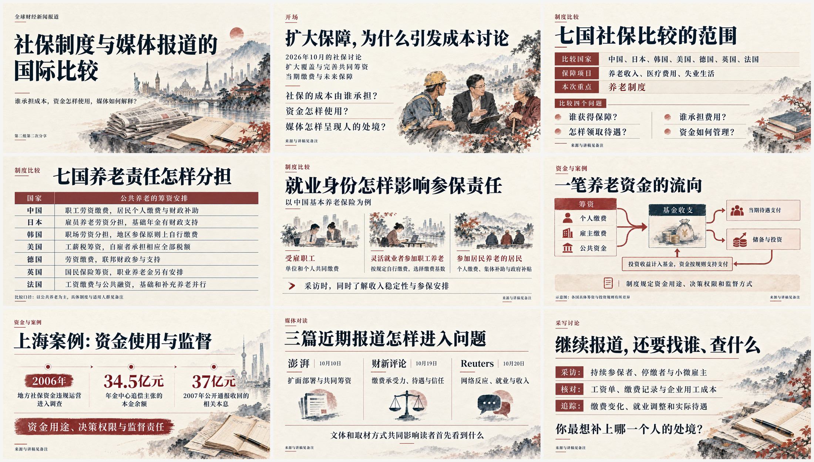

# make-ppt-from-source

[中文](README.md) · [English](README.en.md) · [Download the skill](https://github.com/miraclechen0816/make-ppt-from-source/releases/latest/download/make-ppt-from-source.zip) · [Watch the full film](https://github.com/miraclechen0816/make-ppt-from-source/releases/latest/download/showcase.mp4)

**Choose a complete visual direction first. Finish with both an image-based deck and an editable PowerPoint.**

[](https://github.com/miraclechen0816/make-ppt-from-source/releases/latest/download/showcase.mp4)

An end-to-end agent skill for turning documents, data and existing materials into presentations. It covers content planning, visual selection, slide generation, image placement, editable reconstruction and a matching speaking script.

## See the workflow


The full film runs for about 100 seconds in 1080p. Personal names and private identifiers are masked in the display assets. Most examples use nine-slide grids to show the quality of the whole deck.

## Four decisions that shape the workflow

- **Choose the whole-deck style first.** Preview five directions. Each gets a separate 3×3 grid with a cover, seven representative content slides and a closing slide. Production starts after the user chooses.
- **Finish the layout before inserting images.** Reserve clean slots for photos, screenshots and charts. Assemble the layout draft, then insert the matching assets and check their sources, cropping and data.
- **Deliver the same design in two forms.** The image deck preserves the finished slide artwork. The editable deck contains native text, shapes, tables and supported data charts, with complex artwork as separate image objects.
- **Keep the useful working materials.** Save deck and per-slide prompts, image-slot records, final slide images, object maps and the speaking script.

## Different production paths

| Skill | Main path | Focus |
|---|---|---|
| make-ppt-from-source | Sources → whole-deck previews → slide images → object reconstruction → two PPTX files | Confirm the visual result, then retain editing flexibility |
| ppt-master | Sources → SVG layouts → native PPTX | Organize slides with vector objects |
| html-ppt | Content → HTML/CSS → browser presentation | Browser interaction, themes and presenter mode |

This comparison describes production paths and default deliverables. Results depend on the material, design choices and execution.

## Five complete style previews

The same nine pages appear in all five directions.

<details>
<summary>Open all five nine-slide grids</summary>

**A · Sports magazine**


**B · Research yearbook**


**C · Sports collage**


**D · Modern editorial**



**E · Midnight data**



</details>

## Content-slide examples




## Install and use

Download the [skill package](https://github.com/miraclechen0816/make-ppt-from-source/releases/latest/download/make-ppt-from-source.zip) and place its `make-ppt-from-source` folder in your agent's skills directory. The repository copy is at `skills/make-ppt-from-source/`.

Ask an agent with skill and image-generation support:

```text
Use make-ppt-from-source to create a presentation from my materials.
Show five visual directions first, each as a nine-slide grid with a cover, content slides and an ending. Wait for my selection.
Reserve image slots, insert the assets after assembling the layout draft, and deliver both image-based and editable PPTX files with a speaking script.
```

Image generation uses the tools available and authorized in the current host. The skill includes no credentials and grants no external-service permissions.

### Run the included builder

Python 3.10 or later. Install dependencies in a project-local virtual environment.

```text
python -m pip install -r requirements.txt
python skills/make-ppt-from-source/scripts/build_decks.py examples/native-objects/manifest.json --out-dir output-example
```

The agent reads the final slides and source copy to create the object manifest. The builder then writes deterministic PPTX files with native text, basic shapes, connectors, tables, pictures and supported charts. Photos and complex artwork remain separate image objects with their original pixels.

```text
python skills/make-ppt-from-source/scripts/inspect_pptx.py output-example/native-example_editable.pptx
python skills/make-ppt-from-source/scripts/render_deck.py output-example/native-example_editable.pptx --out review-example
```

Rendering uses installed PowerPoint on Windows, or LibreOffice and PyMuPDF on other platforms. See the [editable-conversion contract](skills/make-ppt-from-source/references/editable-conversion.md).

## Default deliverables

Two PPTX files, five style grids, two prompt documents, final slide images, image-slot records, the object manifest and a speaking script. Editable author, creator and last-modifier identity fields default to `用户`.

## Validation

```text
python -m unittest discover -s tests -v
```

Tests cover native objects, chart data, workbook identity metadata, original image pixels, nine-grid ordering and existing-file protection. The release also includes an actual PowerPoint render comparison of the two output types. `examples/native-objects/` is a runnable structural example.

Code and documentation are managed separately from showcase media. Third-party photos, trademarks and quoted material retain their respective rights; the media illustrates the presentation workflow.
