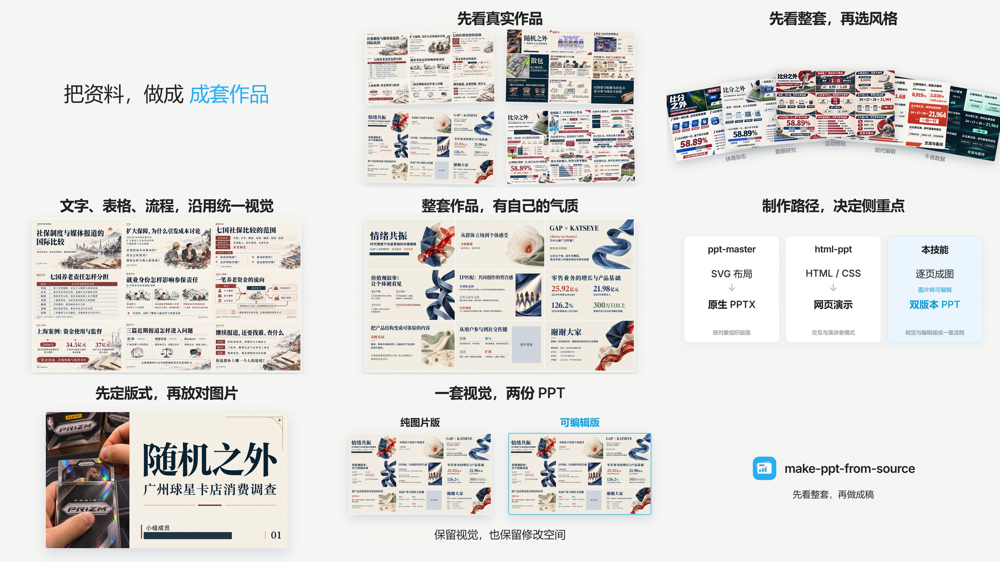
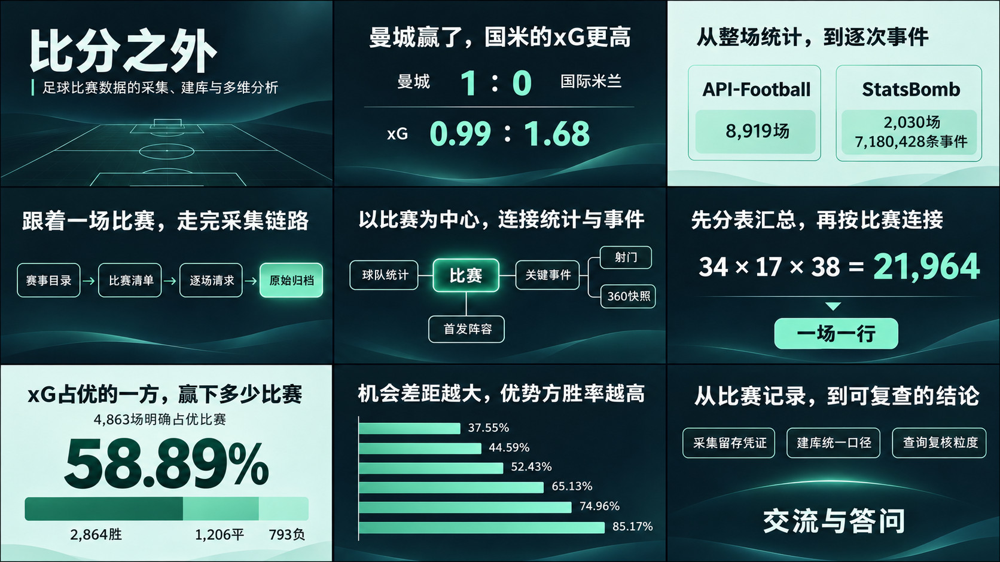
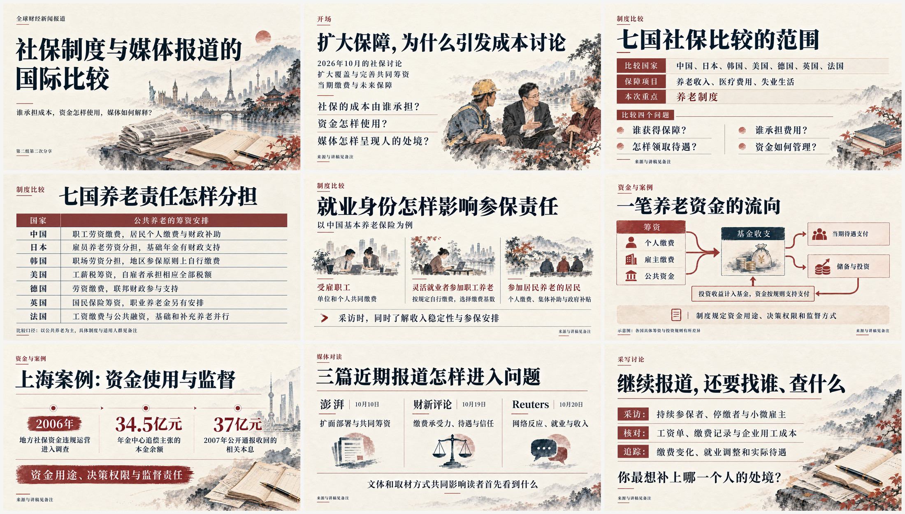

# make-ppt-from-source

[中文](README.md) · [English](README.en.md) · [下载安装包](https://github.com/miraclechen0816/make-ppt-from-source/releases/latest/download/make-ppt-from-source.zip) · [完整展示片](https://github.com/miraclechen0816/make-ppt-from-source/releases/latest/download/showcase.mp4)

**先看整套风格，再做完整PPT。视觉定稿后，同时交付图片版与可编辑版。**

[](https://github.com/miraclechen0816/make-ppt-from-source/releases/latest/download/showcase.mp4)

从文档、数据和已有材料出发，完成内容梳理、风格选择、逐页绘制、配图插入与演讲稿。这是一套供智能代理执行的完整制作流程，适合课程展示、研究汇报、项目答辩和商务提案。

## 看看它怎样工作


完整展示片约100秒，1080p。姓名等隐私已在素材层遮盖。示例包含社保报道、球星卡、足球数据和品牌内容分析，主要以九宫格呈现整套页面。

## 四个贯穿全程的决定

- **先选整套风格。** 默认展示5种方案，每种一张九宫格，包含封面、7张代表性正文和结尾。选定后开始正式全稿。
- **先做好版式，再补齐素材。** 绘制时为照片、截图和图表留出位置，底稿组装后插入对应素材，核对原图、裁切与数据。
- **同一视觉，交付两份PPT。** 图片版保留完整成图；可编辑版把普通文字、图形、表格和可还原的数据图表写成原生对象，复杂视觉保留为独立图片。
- **把过程与讲稿留下。** 完整提示词、逐页绘图提示词、图片位置清单、最终成图、对象清单和配套演讲稿一起保存。

## 与其他制作路径的区别

| 技能 | 主要制作路径 | 侧重点 |
|---|---|---|
| make-ppt-from-source | 资料 → 整套风格预览 → 逐页成图 → 对象化转换 → 双版本PPT | 先确认视觉效果，再保留后续编辑能力 |
| ppt-master | 资料 → SVG布局 → 原生PPTX | 通过矢量对象组织页面 |
| html-ppt | 内容 → HTML/CSS → 网页演示 | 浏览器交互、主题与演讲者模式 |

这里比较制作路线与默认交付。具体效果取决于内容、设计和实际制作。

## 五种风格，看完整页面

以下五张图使用同一组九页内容。封面、正文与结尾一起进入比较。

<details>
<summary>展开五种风格九宫格</summary>

**A · 体育杂志**


**B · 数据研究**


**C · 运动拼贴**


**D · 现代编辑**


**E · 午夜数据**



</details>

## 正文案例




## 安装与使用

下载[安装包](https://github.com/miraclechen0816/make-ppt-from-source/releases/latest/download/make-ppt-from-source.zip)，将其中的 `make-ppt-from-source` 文件夹放入你的代理技能目录。仓库内的技能位于 `skills/make-ppt-from-source/`。

在支持技能与图像生成的代理中使用：

```text
使用 make-ppt-from-source，根据我提供的资料制作一套课程展示。
先给我5种风格，每种用含封面、正文和结尾的九宫格展示，等我选定。
正文先预留图片位置，组装后补齐配图，最后给我图片版和可编辑版PPT，以及配套讲稿。
```

图像生成使用当前主机提供且由用户允许的工具。技能不附带密钥，也不自动授权外部服务。

### 运行内置构建器

Python 3.10+。建议在项目虚拟环境内安装依赖。

```text
python -m pip install -r requirements.txt
python skills/make-ppt-from-source/scripts/build_decks.py examples/native-objects/manifest.json --out-dir output-example
```

对象清单由代理根据最终成图和准确原文建立。构建器负责确定性地写入PPTX，支持文字、基础图形、连线、表格、图片和原生图表。照片、插图等素材保持独立图片对象，并保留原生像素。

```text
python skills/make-ppt-from-source/scripts/inspect_pptx.py output-example/native-example_editable.pptx
python skills/make-ppt-from-source/scripts/render_deck.py output-example/native-example_editable.pptx --out review-example
```

Windows渲染使用本机PowerPoint。其他平台使用LibreOffice与PyMuPDF。详见[可编辑转换规范](skills/make-ppt-from-source/references/editable-conversion.md)。

## 默认交付

两份PPTX、5张风格预览、两份提示词文档、最终成图、图片位置清单、对象清单与演讲稿。输出作者、创建者、最后修改者等身份字段默认为“用户”。

## 验证

```text
python -m unittest discover -s tests -v
```

测试覆盖原生对象、图表数据、内嵌工作簿署名、图片像素保留、九宫格顺序及已有文件保护。发布前还使用实际PowerPoint渲染图片版与可编辑版，对照检查布局。`examples/native-objects/` 是可直接运行的结构自检样例。

代码和文档与展示媒体分别管理。示例中的照片、商标和引用内容保留各自权利，展示媒体用于说明制作效果。
